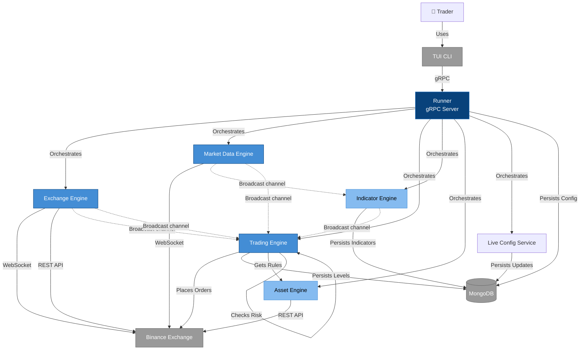
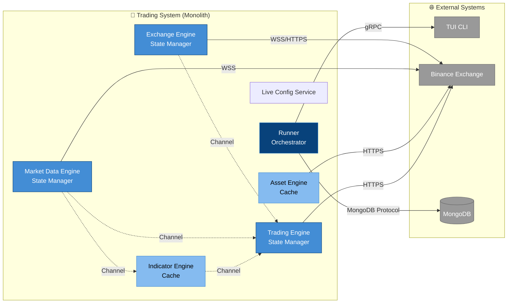
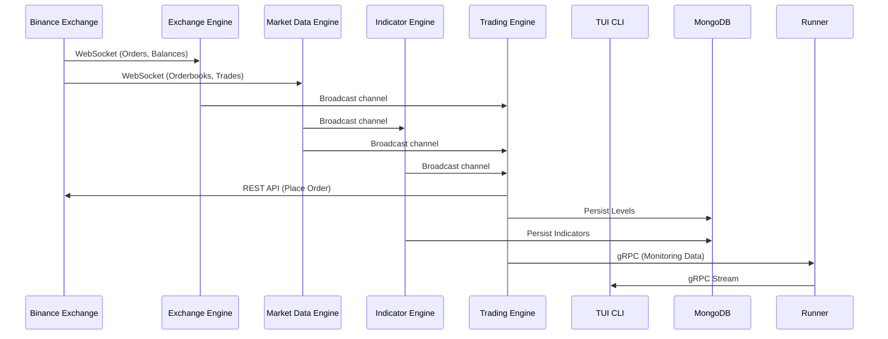

# Trading System

**Version**: 0.1  
**Last Updated**: 2026-11-27  
**License**: Apache License 2.0 (see [LICENSE](LICENSE) and [NOTICE](NOTICE))  
**Copyright**: © 2024–2026 T.L.P. Arc Entertainment Ltd.

## What this is

Rust workspace for a **modular trading runtime**: market data, exchange adapters, in-process risk and trading engines, gRPC operator control, and optional research tooling. One process hosts the live engines; [**k-paper**](https://github.com/Kolzodev712/k-paper) (paper exchange) and [**trading-system-ui**](https://github.com/Kolzodev712/trading-system-ui) (browser console) are **separate repositories**.

**Architecture (current):** [docs/ARCHITECTURE.md](docs/ARCHITECTURE.md) — pure models in `strategy_core`, historical eval in `research_engine` / `research_cli`, live composition via `btc_price_ma_app` and `ExtraStrategyFactory`, generic `runner` for levels and built-in strategies. Narrative: [docs/Trading-System-Analysis.txt](docs/Trading-System-Analysis.txt). Status gates: [docs/PROGRESSION.md](docs/PROGRESSION.md).

**Ecosystem map:** implementation docs here; runnable lab in sibling [**trading-system-showcase**](../trading-system-showcase) (`lab/` Compose).

## Qualification boundaries (read first)

| Claim | Status |
| --- | --- |
| Production / mainnet ready | **No** |
| Candidate #2 (`btc_price_ma_app`) | Operational **baseline** on Paper/Demo paths — **not** validated alpha |
| Paper / Demo runs | Integration and operator qualification — **not** evidence of live P&L |
| Backtests (`research_cli`) | Research replay — **not** linked to the live runner |

Do not infer trading permission from config labels alone; see [docs/VENUE_MODES.md](docs/VENUE_MODES.md) and [docs/EXCHANGE_CAPABILITY_MATRIX.md](docs/EXCHANGE_CAPABILITY_MATRIX.md).

## Run Paper (supported paths)

**Local qualification (this repo):**

```bash
# Mongo + k-paper on loopback; see CONTRIBUTING.md
just test-paper
```

Related: `just test-paper-negative`, `just test-paper-ui` (UI repo checkout).

**Full-stack laboratory (recommended for newcomers):** sibling [trading-system-showcase/lab](../trading-system-showcase/lab/README.md) — builds runner, k-paper, and UI; loopback-only; trading disabled until enabled in the UI.

```bash
cd ../trading-system-showcase/lab && cp .env.example .env && make doctor && make build && make demo
```

**From source (developers):** `cargo build -p runner` or `-p btc_price_ma_app` with [rust-toolchain.toml](rust-toolchain.toml). Spot levels smoke against k-paper is documented in k-paper’s DEV-GUIDE; Candidate #2 Paper gates use the linear USDT fixture — not the same as levels smoke.

**Docker:** root [Dockerfile](Dockerfile) is **obsolete**. Use [trading-system-showcase/lab](../trading-system-showcase/lab/README.md) for containers, or host build + [Dockerfile.paper-bin](Dockerfile.paper-bin) for a thin runtime image.

## Extend the system

1. **Pure strategy model** — implement in `libs/strategy_core` (no I/O); evaluate with `research_engine` / `research_cli`.
2. **Live Candidate** — add an `ExtraStrategyFactory` (see `src/btc_price_ma_app`) and a composition binary that injects it into `runner::run()`; do not embed model logic in `trading_engine`.
3. **Venue client** — implement under `exchange_engine` / `market_data_engine`; wire in `config/bot.json`. Capability honesty: [docs/EXCHANGE_CAPABILITY_MATRIX.md](docs/EXCHANGE_CAPABILITY_MATRIX.md).
4. **Levels / generic strategies** — configure Mongo + `runner --mode levels|strategies` (legacy paths; see [docs/STRATEGY_GUIDE.md](docs/STRATEGY_GUIDE.md) for strategy modes).

There is **no** dynamic plugin registry; new behavior ships as workspace crates and explicit composition binaries.

## Table of Contents

- [Overview](#overview)
- [System Architecture](#system-architecture)
- [Services Overview](#services-overview)
- [Prerequisites & Dependencies](#prerequisites--dependencies)
- [Installation](#installation)
- [Configuration](#configuration)
- [Running the System](#running-the-system)
- [Testing](#testing)
- [Maintenance](#maintenance)
- [Troubleshooting](#troubleshooting)
- [Architecture Documentation](#architecture-documentation)

## Overview

The Trading System is a modular trading platform that supports:

- **Level-Based Trading**: Predefined trading levels with indicator-based price/quantity resolution
- **Strategy-Based Trading**: Algorithmic trading strategies (e.g., BuyLowSellHigh)
- **Real-Time Market Data**: WebSocket-based orderbook and trade streaming
- **Risk Management**: Comprehensive risk checks, circuit breakers, and daily loss limits
- **TUI CLI**: Terminal-based interface for monitoring and level management
- **Exchange Integration**: Supports Binance (spot) and Bybit (spot and futures), extensible to other exchanges

### Key Features

- ✅ **Exchange-Agnostic Design**: Easy to add new exchanges
- ✅ **In-process events**: Tokio broadcast channels between engines (latency not benchmarked in public docs; treat microsecond claims as **unverified**)
- ✅ **State Management**: Full state reconciliation and persistence
- ✅ **Real-Time Monitoring**: TUI CLI with live data streaming
- ✅ **Risk Management**: Circuit breakers, position limits, daily loss limits
- ✅ **Level Management**: Full CRUD operations via TUI or gRPC
- ✅ **Indicator Engine**: Real-time technical indicators (SMA, EMA, composite)
- ✅ **Rate Limiting**: Automatic rate limit enforcement with 429 error handling
- ✅ **Order Amendments**: Automatic order amendments when price/quantity changes (no cancel+place)
- ✅ **Distributed Tracing**: Hybrid tracing system with OpenTelemetry integration
- ✅ **Comprehensive Testing**: Unit tests and integration tests

## System Architecture

Live CEX services in this repository run **in-process** and communicate on broadcast channels. That is one container, not the whole system: `k-paper` (Paper exchange) and `trading-system-ui` (browser operator UI) are separate repositories. Candidate #2 is composed by `btc_price_ma_app`; `strategy_core` and `research_engine` are decoupled from the generic runner. See [docs/ARCHITECTURE.md](docs/ARCHITECTURE.md).

### High-Level Architecture

<details>
<summary><b>📊 Interactive Architecture Diagram</b> (Click to expand)</summary>

> **💡 Tip**: For interactive diagrams with zoom, pan, and filtering, use the [Structurizr architecture diagram](architecture/STRUCTURIZR.md). You can also export it to various formats (Mermaid, PlantUML, PNG, SVG).

#### System Context Diagram



#### Container View (Services)



#### Data Flow Diagram



</details>

#### ASCII Architecture Diagram

```
┌─────────────────────────────────────────────────────────┐
│              Trading System (Monolith)                   │
│                                                          │
│  ┌──────────────────┐      ┌──────────────────┐        │
│  │ Exchange Engine  │      │ Market Data     │        │
│  │ (State Manager)  │      │ Engine          │        │
│  │                 │      │ (State Manager) │        │
│  └────────┬────────┘      └────────┬─────────┘        │
│           │                         │                  │
│           │                         │                  │
│  ┌────────▼────────────────────────▼─────────┐        │
│  │         Trading Engine                    │        │
│  │  (State Manager + Execution)             │        │
│  └────────┬──────────────────────────────────┘        │
│           │                                             │
│  ┌────────▼────────┐      ┌──────────────────┐        │
│  │ Indicator       │      │ Risk Engine      │        │
│  │ Engine (Cache)  │      │ (Cache)          │        │
│  └─────────────────┘      └──────────────────┘        │
│                                                          │
│  ┌──────────────────┐      ┌──────────────────┐        │
│  │ Asset Engine     │      │ Live Config      │        │
│  │ (Cache)          │      │ Service          │        │
│  └──────────────────┘      └──────────────────┘        │
│                                                          │
│  ┌──────────────────────────────────────────┐          │
│  │         Runner (Orchestrator)            │          │
│  │  + gRPC Server (for TUI CLI)            │          │
│  └──────────────────────────────────────────┘          │
└─────────────────────────────────────────────────────────┘
           │
           │ gRPC
           │
┌──────────▼──────────┐
│    TUI CLI           │
│  (External Process)  │
└──────────────────────┘
```

### Communication Patterns

- **In-Process**: Broadcast channels between engines (throughput-oriented; **no published latency SLO**)
- **External**: gRPC (TUI CLI and optional standalone proxy); Zenoh (events and commands, **opt-in** via `ZENOH_ENABLED=1`, default off)
- **Exchange**: WebSocket + REST API (for exchange communication)

### View Interactive Diagrams

For interactive architecture diagrams with zoom, pan, and filtering capabilities:

1. **Structurizr Diagrams**: See [STRUCTURIZR.md](architecture/STRUCTURIZR.md) for instructions on viewing the full Structurizr architecture diagrams
2. **Export Options**: Export to Mermaid, PlantUML, PNG, SVG formats
3. **Component Details**: View detailed component-level diagrams for each service

For detailed architecture information, see the [Architecture Documentation](#architecture-documentation) section.

## Services Overview

### Core Services

#### 1. Exchange Engine
**Purpose**: Single point of contact with exchange for account data (balances, orders, trades).

**Key Features**:
- WebSocket and REST API integration
- State management with reconciliation
- Broadcast channel publishing
- Exchange-agnostic design
- **Rate limiting**: Automatic rate limit enforcement (REQUEST_WEIGHT, ORDERS)
- **429 handling**: Automatic retry with `retryAfter` support
- **Order amendments**: Native order modification API (amend instead of cancel+place)

**See**: [Exchange Engine Architecture](architecture/01-exchange-engine.md)

#### 2. Market Data Engine
**Purpose**: Manages public market data (orderbooks, public trades).

**Key Features**:
- Real-time orderbook streaming
- Public trade streaming
- Channel-based publishing
- Symbol registry integration

**See**: [Market Data Engine Architecture](architecture/02-market-data-engine.md)

#### 3. Trading Engine
**Purpose**: Core trading logic and execution (levels and strategies).

**Key Features**:
- Level-based trading with indicator resolution
- Strategy-based trading
- State management and reconciliation
- Risk integration
- **Automatic order amendments**: Amends existing orders when price/quantity changes instead of canceling and placing new

**See**: [Trading Engine Architecture](architecture/03-trading-engine.md)

#### 4. Indicator Engine
**Purpose**: Calculates and provides real-time technical indicator values.

**Key Features**:
- SMA, EMA, composite indicators
- Real-time calculation
- In-memory indicator cache (lookup cost **unverified** in public benchmarks)
- Extensible framework

**See**: [Indicator Engine Architecture](architecture/04-indicator-engine.md)

#### 5. Risk Engine
**Purpose**: Comprehensive risk management for all trading operations.

**Key Features**:
- Circuit breaker pattern
- Daily loss limits (global and per-pair)
- Position and order limits
- Independent verification capability

**See**: [Risk Engine Architecture](architecture/05-risk-engine.md)

#### 6. Asset Engine
**Purpose**: Caches static asset metadata (symbols, trading rules, exchange limits).

**Key Features**:
- TTL-based caching (5 minutes default)
- Trading rules for order validation
- Exchange limits
- Priority system (exchange values override config)

**See**: [Asset Engine Architecture](architecture/06-asset-engine.md)

### Supporting Services

#### 7. Live Config Service
**Purpose**: Runtime configuration updates without restart.

**Key Features**:
- Channel-based API (no HTTP dependencies)
- Validation and audit logging
- MongoDB persistence
- Level and risk limit updates

**See**: [Live Config Service Architecture](architecture/07-live-config-service.md)

#### 8. Runner
**Purpose**: Application orchestrator; runs the trading loop and exposes external interfaces.

**Key Features**:
- **Entry point**: `runner::run()` in the library creates shutdown manager, builds services, and runs strategy or level runner; the `runner` binary is a thin wrapper (config, logging, MongoDB init, then `run()`).
- **Dual mode**: Strategies or levels.
- **gRPC**: Uses the **gateway** crate for all gRPC (proto, server, service handlers). The runner spawns the gRPC server in-process; an optional **standalone gateway binary** can proxy gRPC to a remote runner.
- **Zenoh**: Event gateway (hot/cold/**dex cold** events) and command queryable when `ZENOH_ENABLED=1` or `true`; off by default for local dev.
- Graceful shutdown via `ShutdownManager`.

**See**: [Runner Architecture](architecture/08-runner.md)

#### 9. TUI CLI
**Purpose**: Terminal user interface for monitoring and level management.

**Key Features**:
- Real-time monitoring via gRPC streaming
- Level management (CRUD operations)
- Trading control (enable/disable)
- Level editing and creation

**See**: [TUI CLI Architecture](architecture/09-tui-cli.md)

### Core Libraries

#### Trading Trace Library
**Purpose**: High-performance distributed tracing and observability.

**Key Features**:
- **Hybrid Tracing**: Separate hot/cold tracing paths (`trading_trace`); overhead **not** certified in this README (see crate README; treat μs figures as design targets unless measured locally)
- **OpenTelemetry Integration**: Full OpenTelemetry SDK with Jaeger and Prometheus exporters
- **Correlation IDs**: Link related operations across services
- **Prometheus Metrics**: Pre-configured metrics for trading operations
- **Zero-Copy Design**: Minimal allocations for maximum performance

**See**: [Trading Trace Library README](libs/trading_trace/README.md) for detailed documentation, API reference, usage examples, and integration guide.

#### Gateway (gRPC and external interfaces)
**Purpose**: Owns all gRPC surface (protocol, server, service handlers) and optional standalone proxy.

**Key Features**:
- **gRPC**: Proto definitions, `TradingGrpcServer`, `TradingCliServiceImpl` (monitoring, levels, trading control). The runner depends on the gateway crate and spawns the gRPC server in-process.
- **Standalone proxy**: The `gateway` binary can run as a separate process, forwarding gRPC to a runner instance (e.g. for multi-tenant or network isolation).
- **Layout**: `src/gateway/` with `grpc/` (proto, server, proxy, service); other protocol modules can be added alongside.

#### Trading Networking Library
**Purpose**: External event and command layer (Zenoh transport).

**Key Features**:
- **Events**: Hot (market data), cold (CEX state), and `DexColdEvent` (DEX state); `EventGateway` fans out to transports (e.g. Zenoh).
- **Commands**: Command payloads, router, dispatcher; Zenoh queryable for remote control (enable/disable trading, status, strategy toggle).
- **Zenoh**: Opt-in (`ZENOH_ENABLED=1`); unified bridge in `runner::event_bridge`. See [Platform data plane](docs/PLATFORM_DATA_PLANE.md).

## Prerequisites & Dependencies

### Required Services

#### 1. MongoDB
**Purpose**: Configuration persistence (levels, risk limits, indicators).

**Version**: MongoDB 3.0+ (or compatible)

**Installation**:
```bash
# Using Docker
docker run -d -p 27017:27017 --name mongodb mongo:latest

# Using systemd (Linux)
sudo systemctl start mongod

# Using Homebrew (macOS)
brew services start mongodb-community
```

**Configuration**: Connection string in `config/bot.json`
```json
{
  "mongo": {
    "enabled": true,
    "connection_string": "mongodb://localhost:27017",
    "database": "trading_system"
  }
}
```

**Collections**:
- `bot_configs` - Bot configurations with levels and risk limits
- `indicators` - Indicator definitions
- `strategies` - Strategy configurations

#### 2. Exchange API Access
**Exchanges**: Binance (spot) and Bybit (spot and futures)

**Required**:
- API Key
- API Secret
- Testnet/Production environment selection

**Permissions Needed**:
- Read account information
- Place orders
- Cancel orders
- View order history
- View trade history

**Configuration**: API keys in `config/bot.json` (see [Configuration](#configuration))

**Note**: Sample configurations are available in `sample_config/binance/`, `sample_config/bybit/` (placeholder Spot), `sample_config/bybit-shadow/`, and `sample_config/bybit-demo/` (Bybit Demo Futures BTC/USDT; see [docs/BYBIT_DEMO_RUNBOOK.md](docs/BYBIT_DEMO_RUNBOOK.md)).

### Optional Services

#### Redis
**Status**: Optional (only if Web UI feature is enabled in future)

**Note**: Redis is **not required** for TUI CLI. All internal communication uses broadcast channels.

### System Requirements

#### Hardware
- **CPU**: 2+ cores recommended
- **Memory**: 512MB+ RAM (1GB+ recommended)
- **Network**: Stable internet connection with low latency to exchange
- **Disk**: Minimal (config files, logs)

#### Software
- **Rust**: 1.70+ (stable)
- **Cargo**: Included with Rust
- **Operating System**: Linux, macOS, or Windows
- **Terminal**: ANSI-compatible terminal (for TUI CLI)

### Network Requirements

#### Outbound Connections
- **Binance REST API**: `https://api.binance.com` (production) or `https://testnet.binance.vision` (testnet)
- **Binance WebSocket**: `wss://stream.binance.com` (production) or `wss://testnet.binance.vision` (testnet)
- **Bybit REST API**: `https://api.bybit.com` (production) or `https://api-testnet.bybit.com` (testnet)
- **Bybit WebSocket**: `wss://stream.bybit.com` (production) or `wss://stream-testnet.bybit.com` (testnet)
- **MongoDB**: Connection to MongoDB instance (if enabled)

#### Inbound Connections
- **gRPC Server**: Port 50051 (default, configurable)
- **Health Server**: Port 8080 (default, configurable)

#### Firewall Rules
- Allow outbound HTTPS (443) to exchange APIs
- Allow outbound WebSocket (443) to exchange WebSocket endpoints
- Allow inbound connections to gRPC/HTTP ports (if accessing remotely)
- Allow connections to MongoDB (if remote)

## Installation

### 1. Clone the Repository

```bash
git clone <repository-url>
cd trading_system
```

### 2. Install Rust

If Rust is not installed:

```bash
curl --proto '=https' --tlsv1.2 -sSf https://sh.rustup.rs | sh
source $HOME/.cargo/env
```

### 3. Build the Project

```bash
# Build in release mode (optimized)
cargo build --release

# Or build in debug mode (faster compilation, slower runtime)
cargo build
```

### 4. Docker Installation (Alternative)

**Status (2026-11-27):** The root [`Dockerfile`](Dockerfile) and [`Dockerfile.cli`](Dockerfile.cli) are **out of date** relative to the current workspace (toolchain and crate graph). They are not a supported clean-checkout path. Prefer:

- Local: `cargo build -p runner` (or `btc_price_ma_app`) with [`rust-toolchain.toml`](rust-toolchain.toml) (`1.98.1`)
- Host-built binary + thin runtime: [`Dockerfile.paper-bin`](Dockerfile.paper-bin)
- Integrated paper lab: [trading-system-showcase/lab](../trading-system-showcase/lab/README.md) (`make demo`)

**📖 Historical notes:** [DOCKER.md](architecture/DOCKER.md) (verify against the note above before trusting build steps).

#### Prerequisites
- Docker 20.10+ and Docker Compose 2.0+

#### Quick Start with Docker Compose (legacy / unsupported)

```bash
# Start all services (MongoDB + Trading System)
docker-compose up -d

# View logs
docker-compose logs -f trading-system

# Stop all services
docker-compose down

# Stop and remove volumes (clean slate)
docker-compose down -v
```

#### Building Docker Images

```bash
# Build runner image
docker build -t trading-system:latest -f Dockerfile .

# Build CLI image
docker build -t trading-system-cli:latest -f Dockerfile.cli .

# Or use the rebuild script (recommended)
./scripts/rebuild.sh              # Quick rebuild (uses cache)
./scripts/rebuild.sh --no-cache   # Full rebuild (no cache)
```

#### Running with Docker

**Trading System Runner:**
```bash
# Run in levels mode (default)
docker run -d \
  --name trading-system \
  -p 50051:50051 \
  -p 8080:8080 \
  -v $(pwd)/config:/app/config:ro \
  --network trading-network \
  trading-system:latest

# Run in strategies mode
docker run -d \
  --name trading-system \
  -p 50051:50051 \
  -p 8080:8080 \
  -v $(pwd)/config:/app/config:ro \
  trading-system:latest \
  --mode strategies --strategies-config /app/config/strategies.json
```

**TUI CLI (Interactive):**
```bash
# Run TUI CLI connected to trading system
docker run -it --rm \
  --network trading-network \
  trading-system-cli:latest \
  http://trading-system:50051

# Or connect to localhost (if runner is on host)
docker run -it --rm \
  --network host \
  trading-system-cli:latest \
  http://localhost:50051
```

#### Docker Architecture

**Why Separate Containers?**

1. **Runner Container**: Long-running service with gRPC server
   - Runs continuously
   - Handles trading logic
   - Exposes gRPC (50051) and health (8080) ports

2. **TUI CLI Container**: Interactive terminal interface
   - Run on-demand when needed
   - Connects to runner via gRPC
   - Requires interactive terminal (`-it` flag)

3. **MongoDB Container**: Configuration persistence
   - Optional but recommended
   - Managed via docker-compose

**Benefits:**
- ✅ Isolated dependencies
- ✅ Consistent environment
- ✅ Easy deployment
- ✅ Resource management
- ✅ Network isolation

**Note**: The TUI CLI is typically run manually when needed, not as a long-running service. Use `docker-compose` for the runner and MongoDB, then run the CLI container interactively when you need to monitor or manage levels.

### 5. Check Dependencies

Use the provided script to check and start dependencies:

```bash
# Check dependencies and ports
./scripts/check_dependencies.sh

# This script will:
# - Check MongoDB connection
# - Check Redis (if enabled)
# - Verify ports are free (gRPC: 50051, Health: 8080)
# - Auto-start missing dependencies in new terminal windows
```

### 5. Configure the System

See [Configuration](#configuration) section for detailed configuration instructions.

## Configuration

### Configuration Files

The system uses three main configuration files:

1. **`config/bot.json`**: Main bot configuration
2. **`config/strategies.json`**: Strategy-specific configuration (for strategy mode)
3. **`config/levels.json`**: Levels-specific configuration (for levels mode)

> **⚠️ Important**: The `config/` directory is ignored by git (contains API keys and sensitive data). You must create this directory manually.

#### Initial Setup

To set up the configuration:

1. **Create the config directory**:
   ```bash
   mkdir -p config
   ```

2. **Copy the sample configuration files** from `sample_config/`:
   ```bash
   # For Binance
   cp sample_config/binance/bot.json config/bot.json
   cp sample_config/binance/strategies.json config/strategies.json
   cp sample_config/binance/levels.json config/levels.json
   cp sample_config/binance/indicators.json config/indicators.json
   
   # Or for Bybit
   cp sample_config/bybit/bot.json config/bot.json
   cp sample_config/bybit/strategies.json config/strategies.json
   cp sample_config/bybit/levels.json config/levels.json
   cp sample_config/bybit/indicators.json config/indicators.json
   ```

   `sample_config/bybit/` is a placeholder Spot ETH/SOL template. For Bybit **Demo** Futures BTC/USDT with Candidate #2, use `sample_config/bybit-demo/` and [docs/BYBIT_DEMO_RUNBOOK.md](docs/BYBIT_DEMO_RUNBOOK.md). Do not launch that path with `scripts/inc10_bybit_demo.sh`.

3. **Edit `config/bot.json`** and add your:
   - Exchange API keys (see [Configuration](#configuration) for structure)
   - MongoDB connection string if different from default

4. **Customize** `config/strategies.json`, `config/levels.json`, and `config/indicators.json` as needed for your trading strategy.

> **Note**: The `sample_config/` directory contains template files without API keys. Always use these as a starting point, then add your own credentials to the `config/` directory.

### Main Configuration (`config/bot.json`)

**Binance Configuration**:
```json
{
  "system": {
    "log_level": "info"
  },
  "exchange_engine": {
    "exchange": "Binance",
    "config": {
      "pairs": ["ETH/USDC", "BTC/USDT"],
      "apiKey": "your_api_key",
      "secret": "your_secret_key"
    }
  },
  "mongo": {
    "enabled": true,
    "connection_string": "mongodb://localhost:27017",
    "database": "trading_system"
  },
```

**Bybit Configuration** (for futures trading):
```json
{
  "system": {
    "log_level": "info"
  },
  "exchange_engine": {
    "exchange": "Bybit",
    "config": {
      "pairs": ["ETH/USDC", "BTC/USDT"],
      "instrumentType": "Futures",
      "credentials": {
        "apiKey": "your_api_key",
        "apiSecret": "your_secret_key"
      }
    }
  },
  "server": {
    "grpc": {
      "bind_address": "0.0.0.0",
      "port": 50051
    },
    "health": {
      "bind_address": "0.0.0.0",
      "port": 8080
    }
  },
  "channels": {
    "market_data_capacity": 1000,
    "exchange_update_capacity": 1000,
    "indicator_update_capacity": 1000
  },
  "reconciliation": {
    "enabled": true,
    "exchange_level_interval_ms": 180000,
    "trading_level_interval_ms": 180000
  },
  "risk": {
    "total_max_position": null,
    "max_total_orders": null,
    "daily_loss_limit_all_pairs": null,
    "daily_loss_limit_per_pair": {}
  }
}
```

### Levels Configuration (`config/levels.json`)

Level templates use `"price": "Binding"` when price comes from indicators; see `config/indicators.json` → `level_pricing`. Full field reference: [Levels Guide](docs/LEVELS_GUIDE.md).

```json
{
  "levels": [
    {
      "id": "buy_level_1",
      "name": "Buy at SMA-0.5%",
      "side": "Buy",
      "order_type": "Limit",
      "quantity": { "type": "Fixed", "value": "0.002" },
      "price": "Binding",
      "enabled": true
    }
  ]
}
```

### Indicators configuration (`config/indicators.json`)

Generated or edited by the Python **indicator config generator** (`python/`). Registers SMA/EMA (and composites) plus **`level_pricing`** rows keyed by level template `id`.

```bash
cd python && uv sync
uv run indicator-generate --pairs BTCUSDT,ETHUSDT --output ../config/indicators.json
uv run indicator-validate --config ../config/indicators.json
```

At startup, the indicator engine loads **MongoDB first** (if enabled), then merges from this file. Details: [indicator_config_generator/README.md](python/indicator_config_generator/README.md), [Levels Guide](docs/LEVELS_GUIDE.md).

### Strategies Configuration (`config/strategies.json`)

```json
{
  "strategy_type": "BuyLowSellHigh",
  "symbol": {
    "base": "BTC",
    "quote": "USDT"
  },
  "position_size": 0.001,
  "max_position": 0.01,
  "buy_threshold_percent": 2.0,
  "sell_threshold_percent": 2.0,
  "stop_loss_percent": 5.0,
  "take_profit_percent": 10.0,
  "max_active_orders": 5,
  "price_history_size": 100,
  "min_price_history": 20
}
```

**Configuration Parameters**:
- `strategy_type`: Strategy name (currently "BuyLowSellHigh")
- `symbol`: Trading pair (base and quote currencies)
- `position_size`: Base position size per trade
- `max_position`: Maximum total position size
- `buy_threshold_percent`: Percentage below average price to trigger buy
- `sell_threshold_percent`: Percentage above average price to trigger sell
- `stop_loss_percent`: Stop loss percentage (optional)
- `take_profit_percent`: Take profit percentage (optional)
- `max_active_orders`: Maximum number of active orders
- `price_history_size`: Size of price history buffer
- `min_price_history`: Minimum price history required before trading

For detailed strategy documentation, see [Strategy Guide](docs/STRATEGY_GUIDE.md).

### Environment Variables (Optional)

API keys can be provided via environment variables for security:

```bash
export BINANCE_API_KEY=your_api_key
export BINANCE_API_SECRET=your_secret_key
export MONGODB_URI=mongodb://localhost:27017
```

## Running the System

For the existing **Spot/levels Paper smoke test** with K-paper, the runner and legacy TUI, see the [local dev guide](docs/LOCAL_DEV_GUIDE.md).

Architecture: [docs/ARCHITECTURE.md](docs/ARCHITECTURE.md). Progression: [docs/PROGRESSION.md](docs/PROGRESSION.md). The browser UI is the operator console; the TUI is a separate gRPC client.

### Pre-Flight Checks

Before starting the system, run the dependency check script:

```bash
./scripts/check_dependencies.sh
```

This script will:
- Check MongoDB connection
- Check Redis (if enabled)
- Verify ports are free (gRPC: 50051, Health: 8080)
- Auto-start missing dependencies in new terminal windows

### Running in Levels Mode

**Levels mode** is the default mode and supports level-based trading with indicator resolution.

#### 1. Start the Trading System

```bash
# Default (levels mode) — use --bin runner (package also builds test_runner)
cargo run --release --package runner --bin runner

# Explicit levels mode
cargo run --release --package runner --bin runner -- --mode levels

# With custom levels config
cargo run --release --package runner --bin runner -- --mode levels --levels-config config/levels.json
```

#### 2. Start the TUI CLI (Optional)

In a **separate terminal**, start the TUI CLI:

```bash
# Connect to default gRPC endpoint
cargo run --release --package cli

# Or specify custom endpoint
cargo run --release --package cli -- http://localhost:50051
```

#### 3. Using the TUI CLI

Once the TUI starts, you'll see:

- **Main Menu**: Trading status and navigation
- **Spot Monitor** or **Futures Monitor**: Real-time display (automatically selected based on instrument type)
  - Spot Monitor: Orders, balances, levels/strategies, indicators, trades
  - Futures Monitor: Positions, margin info, orders, orderbook, indicators, trades

**Navigation**:
- `↑/↓`: Navigate levels
- `T`: Toggle level enabled/disabled
- `L`: View level details
- `E`: Edit level
- `C`: Create new level
- `Tab`: Switch between panels
- `Esc`: Close popup/form
- `Q`: Quit

### Running in Strategies Mode

**Strategies mode** supports algorithmic trading strategies (e.g., Buy Low, Sell High).

#### 1. Start the Trading System

```bash
# Strategies mode
cargo run --release --bin runner -- --mode strategies

# With custom strategies config
cargo run --release --bin runner -- --mode strategies --strategies-config config/strategies.json
```

#### 2. Start the TUI CLI (Optional)

In a **separate terminal**, start the TUI CLI:

```bash
# Connect to default gRPC endpoint
cargo run --release --package cli

# Or specify custom endpoint
cargo run --release --package cli -- http://localhost:50051
```

#### 3. Using the TUI CLI in Strategies Mode

Once the TUI starts, you'll see:

- **Main Menu**: Trading status and navigation
- **Spot Monitor** or **Futures Monitor**: Real-time display with **Strategy panel** (replaces Levels panel in strategies mode)
  - Strategy status per strategy (Running/Paused, enabled/disabled)
  - Current position and average price per strategy
  - Unrealized P&L per strategy
  - Active orders count per strategy
  - Last signal per strategy
  - Strategy selection (↑/↓ keys to navigate between strategies)

**Navigation**:
- `T`: Toggle selected strategy on/off (in strategies mode) or toggle selected level (in levels mode)
- `R`: Refresh data
- `Esc`: Back to main menu
- `Q`: Quit

**Trading Control**:
- **Strategies Mode**: Press `T` to toggle the selected strategy (enable/disable individual strategy)
  - Each strategy can be enabled/disabled independently
  - When disabled, the strategy continues monitoring but won't place orders
  - Strategy panel shows "●" (green) when enabled, "⏸" (red) when disabled for each strategy
  - Disabling a strategy automatically cancels its active orders
- **Levels Mode**: Press `T` to toggle the selected level (enable/disable individual level)

### Running Test Binary

The system includes a test binary for full system testing in no-trade mode:

```bash
# Run in levels mode for 60 seconds with verbose logging
cargo run --bin test_runner -- --mode levels --duration 60 --verbose

# Run in strategies mode
cargo run --bin test_runner -- --mode strategies --duration 30
```

**Use Cases**:
- Integration testing
- System validation
- Debugging without placing real orders

### Command-Line Arguments

#### Runner Arguments

```bash
cargo run --package runner -- \
  --mode <strategies|levels> \      # Trading mode (default: levels)
  --strategies-config <path> \       # Strategies config path (default: config/strategies.json)
  --levels-config <path>            # Levels config path (default: config/levels.json)
```

#### TUI CLI Arguments

```bash
cargo run --package cli -- <endpoint>  # gRPC endpoint (default: http://localhost:50051)
```

### Graceful Shutdown

Press `Ctrl+C` to initiate graceful shutdown:
- All components receive shutdown signal
- Active orders are handled
- Connections are closed cleanly
- Timeout: 30 seconds (configurable in config)

## Testing

### Unit Tests

Run all unit tests:

```bash
# Run all tests
cargo test

# Run tests for specific crate
cargo test --package trading_engine

# Run with output
cargo test -- --nocapture
```

### Integration Tests

The system includes comprehensive integration tests organized in a modular structure:

```bash
# Run all integration tests
cargo test --test integration

# Run specific integration test module
cargo test --test integration levels

# Run ignored tests (requires external services)
cargo test --test integration -- --ignored
```

#### Integration Test Structure

Tests are organized in `tests/integration/`:

- **`config.rs`**: Configuration loading and validation
- **`levels.rs`**: Level management system
- **`risk.rs`**: Risk management system
- **`trading_state.rs`**: Trading state management
- **`circuit_breaker.rs`**: Circuit breaker functionality
- **`market_data.rs`**: Market data engine
- **`indicator.rs`**: Indicator engine
- **`asset.rs`**: Asset engine
- **`exchange.rs`**: Exchange engine (with `#[ignore]` for external calls)
- **`live_config.rs`**: Live config service
- **`level_execution.rs`**: Level execution and resolver
- **`workflows.rs`**: End-to-end workflows
- **`risk_metrics.rs`**: Risk metrics calculation
- **`channels.rs`**: Inter-service channel communication

#### Test Helpers

Common test utilities are in `tests/integration/helpers.rs`:
- `create_test_level_config()` - Create test level configuration
- `create_test_risk_manager()` - Create test risk manager
- `create_test_order()` - Create test order
- `create_test_balance()` - Create test balance
- `create_test_exchange_state_manager()` - Create test exchange state manager
- `create_test_market_data_manager()` - Create test market data manager

#### Ignored Tests

Tests that require external calls (exchange API, network) are marked with `#[ignore]`:

```bash
# Run ignored tests (requires external services)
cargo test --test integration -- --ignored
```

These tests include:
- Exchange engine trading calls
- WebSocket connections
- External API calls

### Test Coverage

The system includes comprehensive test coverage:

- **Unit Tests**: All services have unit tests
- **Integration Tests**: Modular integration test suite
- **Test Binary**: Full system testing in no-trade mode

### Running Tests in CI/CD

```bash
# Run all tests (excluding ignored)
cargo test --test integration

# Run with coverage (requires cargo-tarpaulin)
cargo tarpaulin --tests --test integration
```

## Local verification (no GitHub Actions)

This repository does **not** ship GitHub Actions. Use local recipes:

```bash
just test-fast          # component + research unit gates
just test-5r-graph      # architectural dependency checks
just test-paper         # Paper workflow qualification (needs Mongo + k-paper)
just test-paper-negative
just test-paper-ui
just ci-local           # combined local Paper qualification
```

Paper and UI layers expect sibling checkouts of `k-paper` and `trading-system-ui`.
For the integrated laboratory, use `trading-system-showcase/lab/` (`make doctor`, `make qualify`).

## Maintenance

### Logging

The system uses structured logging via `tracing`:

**Log Levels**:
- `trace`: Very detailed debugging
- `debug`: Debugging information
- `info`: General information (default)
- `warn`: Warning messages
- `error`: Error messages

**Configuration**: Set log level in `config/bot.json`:
```json
{
  "system": {
    "log_level": "info"
  }
}
```

**TUI CLI Logging**: TUI CLI logs to `cli_debug.log` (doesn't clutter terminal)

### Monitoring

#### Health Endpoints

The system exposes health endpoints on port 8080 (default):

```bash
# Health check
curl http://localhost:8080/health

# Trading state
curl http://localhost:8080/state

# Positions (if available)
curl http://localhost:8080/positions
```

#### Distributed Tracing

The system includes comprehensive distributed tracing via the `trading_trace` library:

- **Hot Path Tracing**: Ultra-lightweight tracing for high-frequency operations (market data, order updates)
- **Cold Path Tracing**: Full OpenTelemetry integration for commands, events, and state management
- **Jaeger Integration**: Export traces to Jaeger for visualization
- **Prometheus Metrics**: Pre-configured metrics for trading operations

**See**: [Trading Trace Library README](libs/trading_trace/README.md) for setup, configuration, and usage.

#### Observability stack (Jaeger + Grafana)

To run Jaeger, Prometheus, and Grafana alongside the trading system:

1. **Start the trading system and observability stack** (Docker). Use the rebuild script so the app sends traces to Jaeger:
   ```bash
   ./scripts/rebuild.sh --observability
   ```
   Or manually: `docker-compose -f docker-compose.yml -f docker-compose.observability.yml up -d`.  
   The observability compose file sets `TRACE_JAEGER_AGENT_ENDPOINT=jaeger:6831` on the trading-system so it can reach the Jaeger agent inside Docker.

2. **See traces in Jaeger**: Open http://localhost:16686 → **Search**. Choose service **trading-system** and click **Find Traces**. Traces appear when the app does work (e.g. exchange updates, level/strategy events). If you see no traces, ensure the stack was started with the observability compose file (so the endpoint is set) and that the trading system is running and connected to an exchange.

3. **See traces in Grafana**: Open http://localhost:3000 (login `admin` / `admin`) → **Explore** (compass icon) → select **Jaeger** as data source → choose service **trading-system** and run a query.

4. **Prometheus**: http://localhost:9090 — scrapes `GET /metrics` from the app. The app exposes `trading_system_info`, `trading_system_start_timestamp_seconds`, etc.

5. **See metrics in Grafana**: Open http://localhost:3000 → **Explore** → select **Prometheus** → run a query, e.g. `trading_system_info` or `time() - trading_system_start_timestamp_seconds` (uptime in seconds). To build a dashboard: **Dashboards** → **New** → **Add visualization** → choose Prometheus and a metric.

Config: `observability/prometheus.yml`, `observability/grafana/provisioning/datasources/datasources.yml`.

#### gRPC Monitoring

Use the TUI CLI for real-time monitoring:
- Real-time data streaming
- Level management
- Trading control

### Backup and Recovery

#### MongoDB Backup

```bash
# Backup MongoDB
mongodump --uri="mongodb://localhost:27017" --db=trading_system --out=/backup/path

# Restore MongoDB
mongorestore --uri="mongodb://localhost:27017" --db=trading_system /backup/path/trading_system
```

**Note**: MongoDB stores configuration only, not trading state. State is in-memory.

### Updates and Upgrades

1. **Backup Configuration**: Backup `config/` directory and MongoDB
2. **Pull Latest Code**: `git pull`
3. **Rebuild**: 
   - Local: `cargo build --release`
   - Docker: `./scripts/rebuild.sh` (or `./scripts/rebuild.sh --no-cache` for clean build)
4. **Test**: Run integration tests
5. **Deploy**: Restart the system

### Performance Tuning

#### Channel Buffer Sizes

Adjust channel buffer sizes in `config/bot.json`:

```json
{
  "channels": {
    "market_data_capacity": 1000,
    "exchange_update_capacity": 1000,
    "indicator_update_capacity": 1000
  }
}
```

#### Reconciliation Intervals

Adjust reconciliation intervals:

```json
{
  "reconciliation": {
    "exchange_level_interval_ms": 180000,  # 3 minutes
    "trading_level_interval_ms": 180000    # 3 minutes
  }
}
```

## Troubleshooting

### Common Issues

#### MongoDB Connection Error

```
Error: MongoDB connection failed
```

**Solution**:
1. Check MongoDB is running: `mongosh --eval "db.adminCommand('ping')"`
2. Verify connection string in `config/bot.json`
3. Check firewall rules
4. Check MongoDB logs

#### gRPC Port Already in Use

```
Error: Address already in use (os error 98)
```

**Solution**:
```bash
# Kill process using port 50051
./scripts/kill_grpc_port.sh

# Or change port in config/bot.json
```

#### Exchange API Error

```
Error: Authentication failed
```

**Solution**:
1. Verify API keys in `config/bot.json`
2. Check API key permissions
3. Verify testnet/production environment
4. Check rate limits

#### Rate Limit Errors (429)

```
Error: Rate limited (429) - Request failed
```

**Solution**:
1. The system automatically handles 429 errors with `retryAfter` waiting
2. Check logs for rate limit usage and patterns
3. Monitor `REQUEST_WEIGHT` and `ORDERS` limits
4. Reduce request frequency if consistently hitting limits
5. Check connection count (Binance: 300 connections per 5 minutes per IP)

#### WebSocket Connection Error

```
Error: Trading WebSocket error
```

**Solution**:
1. Check internet connection
2. Verify Binance API is accessible
3. Check firewall rules
4. Verify API keys are valid

#### TUI CLI Connection Error

```
Error: Failed to connect to gRPC server
```

**Solution**:
1. Ensure runner is running first
2. Check gRPC server started (look for "gRPC server started" in logs)
3. Verify endpoint: `http://localhost:50051`
4. Check firewall rules

#### No Trading Activity

**Possible Causes**:
- Levels disabled (check TUI or MongoDB)
- Risk limits reached
- No market data (check WebSocket connection)
- Price conditions not met (for strategies)

**Debugging**:
1. Check logs for errors
2. Verify levels are enabled in TUI
3. Check risk limits in config
4. Monitor market data flow

### Debug Mode

Run in debug mode for more detailed logging:

```bash
# Set log level to debug in config/bot.json
{
  "system": {
    "log_level": "debug"
  }
}

# Or run with RUST_LOG
RUST_LOG=debug cargo run --package runner
```

### Getting Help

1. Check logs: Look for error messages
2. Check health endpoints: Verify system status
3. Review configuration: Ensure all settings are correct
4. Check architecture docs: Understand system behavior

## Architecture Documentation

**Current:** [docs/ARCHITECTURE.md](docs/ARCHITECTURE.md) · [docs/PROGRESSION.md](docs/PROGRESSION.md) · [docs/Trading-System-Analysis.txt](docs/Trading-System-Analysis.txt) · [architecture/README.md](architecture/README.md)

Older Structurizr/engine diagrams below are in-process views and are not a production or mainnet status.

### Visual Architecture Diagrams

- **[Structurizr Architecture Diagram](architecture/STRUCTURIZR.md)**: Interactive architecture diagrams using Structurizr DSL
  - System Context view
  - Container view
  - Component views for each service
  - Deployment view
  - See [STRUCTURIZR.md](architecture/STRUCTURIZR.md) for usage instructions

### Detailed Architecture Documents

For detailed architecture information, see the [architecture/](architecture/) directory:

- **[Exchange Engine](architecture/01-exchange-engine.md)**: Exchange integration and state management
- **[Market Data Engine](architecture/02-market-data-engine.md)**: Market data streaming
- **[Trading Engine](architecture/03-trading-engine.md)**: Trading logic and execution
- **[Indicator Engine](architecture/04-indicator-engine.md)**: Technical indicator calculation
- **[Risk Engine](architecture/05-risk-engine.md)**: Risk management
- **[Asset Engine](architecture/06-asset-engine.md)**: Asset metadata caching

### Core Libraries

- **[Trading Trace Library](libs/trading_trace/README.md)**: High-performance distributed tracing and observability
  - Hybrid tracing approach (see `libs/trading_trace`; μs overhead figures are **unverified** in this README)
  - OpenTelemetry integration with Jaeger and Prometheus exporters
  - Correlation IDs and metrics support
  - See [Trading Trace Library README](libs/trading_trace/README.md) for complete documentation
- **[Live Config Service](architecture/07-live-config-service.md)**: Runtime configuration updates
- **[Runner](architecture/08-runner.md)**: Application orchestrator
- **[TUI CLI](architecture/09-tui-cli.md)**: Legacy terminal gRPC client (browser operator console is `trading-system-ui`)
- **[Architecture README](architecture/README.md)**: Engine-level docs; current system is [docs/ARCHITECTURE.md](docs/ARCHITECTURE.md); progression is [docs/PROGRESSION.md](docs/PROGRESSION.md)

## Authors

Copyright © 2024–2026 T.L.P. Arc Entertainment Ltd.

## License

Licensed under the Apache License, Version 2.0. See [LICENSE](LICENSE) and
[NOTICE](NOTICE). You may not use this file except in compliance with the License.
Unless required by applicable law or agreed to in writing, software distributed
under the License is distributed on an "AS IS" BASIS, WITHOUT WARRANTIES OR
CONDITIONS OF ANY KIND, either express or implied.

## Contributing

1. Fork the repository
2. Create a feature branch
3. Make your changes
4. Add tests
5. Ensure all tests pass: `cargo test`
6. Run clippy: `cargo clippy`
7. Submit a pull request

## Version History

- **0.1** (December 2024): Initial release
  - Level-based trading
  - Strategy-based trading
  - TUI CLI
  - Comprehensive testing
  - Architecture documentation
