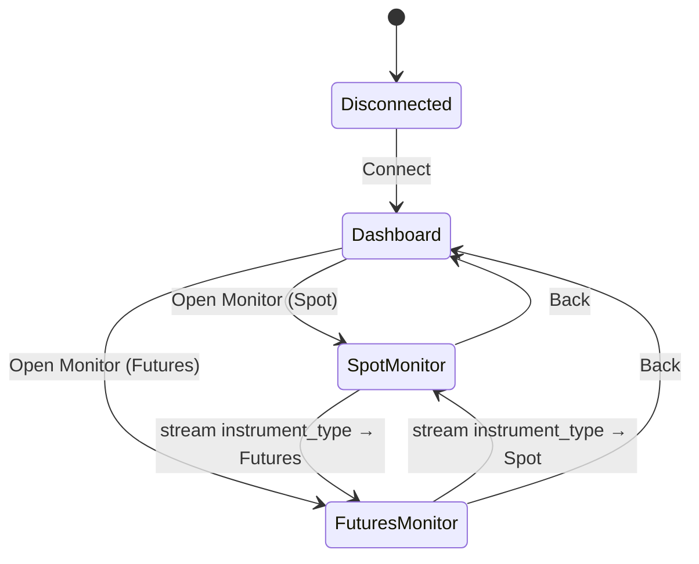

# Trading System Web UI — Feature Reference

**Purpose:** Document how the browser dashboard (`trading-system-ui`) works — architecture, connection path, state, screens, gRPC usage, and parity with the Rust TUI — for operators and developers working on either repo.

**Repository:** [github.com/Kolzodev712/trading-system-ui](https://github.com/Kolzodev712/trading-system-ui) (local clone: `~/Desktop/trading-system-ui`)

**Related:** TUI reference → `docs/features/tui-grpc-reference.md` (if present) · Backend proto → `libs/trading_core/proto/trading_cli.proto`

---

## 1. What it is

The Web UI is a **thin gRPC-Web client**. It replaces the Rust TUI (`trading-cli`) with a React dashboard. It does **not**:

- Read `bot.json`, MongoDB, Redis, or exchange APIs directly
- Duplicate any trading logic

All data and commands go through the same **`TradingCliService`** on the trading runner (`:50051`).

Because browsers cannot speak native gRPC, traffic is bridged through **Envoy** (gRPC-Web → HTTP/2 gRPC).

```
Browser (:5173)  →  Vite proxy (/grpc)  →  Envoy (:8081)  →  Runner gRPC (:50051)
```

| Layer | Technology |
|-------|------------|
| UI | React 19, Tailwind CSS, Radix UI, Lucide icons |
| State | Zustand (UI + snapshots), TanStack Query (levels poll + mutations) |
| RPC | Connect RPC (`@connectrpc/connect-web`) over gRPC-Web |
| Codegen | Buf → `src/gen/trading_cli_pb.ts`, `trading_cli_connect.ts` |
| Proxy | Envoy v1.31 (`docker/envoy.yaml`) |
| Tests | Vitest + Testing Library |

---

## 2. Full stack startup (local dev)

Run these in order:

### Terminal 1 — k-paper (Paper exchange)

```bash
cd ~/Desktop/k-paper
PAPER_EXCHANGE_DUMMY_OB=1 cargo run -p paper-exchange-server
# Default: ws://127.0.0.1:19999/ws/trade
```

### Terminal 2 — trading runner

```bash
cd ~/Desktop/trading_system
cargo run --release --package runner --bin runner -- --mode levels
# Expect: gRPC server started on [::]:50051
```

Ensure `config/bot.json` has `paper_exchange_url: "ws://127.0.0.1:19999/ws/trade"`.

### Terminal 3 — gRPC-Web proxy

```bash
cd ~/Desktop/trading-system-ui
npm run proxy:up
# Envoy listens on :8081, forwards to 127.0.0.1:50051
```

### Terminal 4 — Web UI

```bash
cd ~/Desktop/trading-system-ui
npm install
npm run start
# Opens http://127.0.0.1:5173
```

Click **Connect** (default endpoint `/grpc`).

---

## 3. Network & configuration

### Environment variables (UI)

| Variable | Default | Purpose |
|----------|---------|---------|
| `VITE_GRPC_WEB_URL` | `/grpc` | Browser-facing gRPC-Web base URL (baked in at build) |
| `GRPC_WEB_PROXY` | `http://127.0.0.1:8081` | Vite dev/preview proxy target for `/grpc` |

Copy `.env.example` → `.env` to override.

### Endpoint persistence

The connect URL is stored in **`localStorage`** key `trading.grpc.endpoint` (`src/lib/endpoint.ts`). Default is `/grpc` (relative — works with Vite proxy in dev and same-origin hosting in prod).

### Envoy (`docker/envoy.yaml`)

- Listener: `0.0.0.0:8081`
- Filters: `grpc_web` → `cors` → `router`
- Upstream cluster: `127.0.0.1:50051` (HTTP/2)
- CORS: `*` origins (tighten for production)
- Admin: `:9901`
- Docker compose uses **`network_mode: host`** so Envoy reaches runner on localhost

### Proto contract

`proto/trading_cli.proto` in the UI repo should stay in sync with:

```
trading_system/libs/trading_core/proto/trading_cli.proto
```

Regenerate after changes:

```bash
cp ../trading_system/libs/trading_core/proto/trading_cli.proto proto/
npm run generate
```

---

## 4. Application architecture

### 4.1 Entry & routing

There is **no React Router**. Navigation is a Zustand `screen` field:

| `screen` | Component | When |
|----------|-----------|------|
| `main` | `MainMenu` | After connect, before monitor |
| `spot` | `SpotMonitor` | `instrument_type !== "Futures"` |
| `futures` | `FuturesMonitor` | `instrument_type === "Futures"` |

`App.tsx` wires global hooks and dialogs:

```tsx
useMonitoringStream(connected && screen !== "main");  // live data
useLevelsPoll(connected && screen !== "main", true);  // 5s poll, spot only
```

### 4.2 Screen state machine



**Mode** (`levels` vs `strategies`) is derived — not a separate screen:

```typescript
// strategies.length > 0 → "strategies", else "levels"
export function useMode(): "levels" | "strategies"
```

---

## 5. State model

### 5.1 Zustand store (`src/store/tradingStore.ts`)

| Field | Source | Updated when |
|-------|--------|--------------|
| `connected`, `endpoint`, `connectionError` | User connect flow | `useConnection` |
| `tradingEnabled` | `GetTradingStatus` / toggle | Connect, global switch |
| `monitoringData` | Stream + manual refresh | `useMonitoringStream`, Refresh button |
| `levels` | `GetLevels` poll | `useLevelsPoll` (5s, spot only) |
| `screen` | User + `instrument_type` in stream | `enterMonitor`, `leaveMonitor`, `setMonitoringData` |
| `selectedLevelIndex`, `selectedStrategyIndex`, `selectedOrderbookIndex` | Table clicks / tabs | Panel interaction |
| `overlay` | User actions | Dialogs: `levelDetails`, `strategyDetails`, `createLevel`, `editLevel` |
| `streamConnected` | Stream hook | Backoff/reconnect indicator in status bar |

**Important:** Zustand selectors must use stable empty-array fallbacks from `src/lib/empty.ts` — never `?? []` inline (causes infinite re-renders).

### 5.2 TanStack Query

| Query key | RPC | Interval | Enabled when |
|-----------|-----|----------|--------------|
| `["levels"]` | `GetLevels` | 5s | Connected + in monitor + **spot screen only** |

Mutations invalidate `["levels"]` after create/edit/toggle.

---

## 6. gRPC client layer

### 6.1 Client singleton (`src/api/client.ts`)

```typescript
createGrpcWebTransport({ baseUrl: loadEndpoint() })
createClient(TradingCliService, transport)
```

Client is recreated when endpoint changes. `resetTradingClient()` on connect/disconnect.

**Timeouts:**

| Profile | Duration | Used for |
|---------|----------|----------|
| `default` | 5s | Most RPCs |
| `toggle` | 2s | `SetTradingEnabled`, `ToggleLevel`, `ToggleStrategy` |

### 6.2 RPC wrappers (`src/api/tradingCliService.ts`)

| Function | RPC | UI trigger |
|----------|-----|------------|
| `connectAndFetchInitial()` | `GetTradingStatus` + `GetMonitoringData` | Connect button (parallel) |
| `setTradingEnabled()` | `SetTradingEnabled` | Dashboard global switch |
| `getMonitoringData()` | `GetMonitoringData` | Toolbar Refresh |
| `streamMonitoringData()` | `StreamMonitoringData` | Monitor screens (~1 Hz) |
| `getLevels()` | `GetLevels` | 5s poll (spot) |
| `getLevel()` | `GetLevel` | Level details dialog |
| `createLevel()` | `CreateLevel` | Create dialog |
| `updateLevel()` | `UpdateLevel` | Edit dialog |
| `toggleLevel()` | `ToggleLevel` | Toolbar (levels mode) |
| `toggleStrategy()` | `ToggleStrategy` | Toolbar (strategies mode) |
| `deleteLevel()` | `DeleteLevel` | **Not exposed** (server UNIMPLEMENTED) |

### 6.3 Streaming (`src/hooks/useMonitoringStream.ts`)

- Active when `connected && screen !== "main"`
- Replaces full `monitoringData` snapshot on each tick (not deltas)
- On stream error: exponential backoff 1s → 30s, sets `streamConnected: false`
- `instrument_type` changes auto-switch spot ↔ futures via `setMonitoringData` → `deriveScreen()`

### 6.4 Connection bootstrap (`src/hooks/useConnection.ts`)

On **Connect**:

1. `resetTradingClient()`
2. Parallel: `GetTradingStatus` + `GetMonitoringData`
3. Set store → `connected: true`, show dashboard

On failure: toast error, full store reset.

---

## 7. Data flow (proto → UI)

```
trading_cli.proto
    → buf generate (npm run generate)
    → src/gen/trading_cli_pb.ts + trading_cli_connect.ts
    → src/api/tradingCliService.ts (RPC calls)
    → hooks (stream, poll, mutations)
    → tradingStore (MonitoringData, Level[], flags)
    → src/api/transforms.ts (display rules)
    → panels / dialogs (DataTable, PnlText, EnabledBadge)
```

### Display transforms (`src/api/transforms.ts`)

Replicated from Rust TUI `cli/src/screens/shared/panels.rs`:

| Rule | Behavior |
|------|----------|
| Level enabled badge | ✓ green (enabled + global on); ⏸ yellow (enabled + global off); ✗ red (disabled) |
| Level status | Posted/Created → ●; Filled → ✓; Cancelled → ✗; Paused → ⏸ |
| PnL | Red if starts with `-`, green otherwise |
| Trades | Reversed before display (newest first) |
| Price/qty on create/update | Wrapped as `Fixed(value)` via `wrapFixed()` |
| Edit form | Strips `Fixed(...)` prefix for display |

### Level ID conventions

| Context | ID format | Example |
|---------|-----------|---------|
| List (`GetLevels`) | Expanded `{configId}_{pair}` | `my_level_BTCUSDT` |
| Create form | Bare config id | `my_level` |
| Toggle/update/details | Use `Level.id` from list | `my_level_BTCUSDT` |

Helpers: `configIdFromExpanded()`, `pairFromLevel()` in `src/lib/levelId.ts`.

---

## 8. Screens & components

### 8.1 Main Menu (`screens/MainMenu.tsx`)

- Global trading **Switch** → `SetTradingEnabled`
- **Open Trading Monitor** → `enterMonitor()` (picks spot/futures from current `monitoringData.instrumentType`)
- Footer: exchange name, mode (Levels/Strategies)
- Disconnect button

### 8.2 Spot Monitor (`screens/SpotMonitor.tsx`)

```
┌─────────────────────────────────────────────────────────────┐
│ Toolbar: Back | Refresh | Enable/Disable | Details | New | Edit │
├──────────────┬──────────────────┬───────────────────────────┤
│ Orders       │                  │ Indicators                │
│ Balances     │   Orderbook      │ Aggregated (web-only)     │
│ Levels OR    │   (pair tabs)    │ DEX (web-only, if present)│
│ Strategies   │                  │                           │
├──────────────┴──────────────────┴───────────────────────────┤
│ Recent Trades                                                │
└─────────────────────────────────────────────────────────────┘
```

### 8.3 Futures Monitor (`screens/FuturesMonitor.tsx`)

**Levels mode:** Positions + Levels + Orders | Orderbook | Margin + Indicators  
**Strategies mode:** Strategies + Orders | Orderbook | Margin + Indicators  
Bottom: Trades + Aggregated/DEX extras

### 8.4 Monitor toolbar (`components/layout/MonitorToolbar.tsx`)

| Action | Levels mode | Strategies mode |
|--------|-------------|-----------------|
| Back | `leaveMonitor()` | Same |
| Refresh | `GetMonitoringData` | Same |
| Enable/Disable | `ToggleLevel` on selected | `ToggleStrategy` on selected |
| Details | `GetLevel` → dialog | Strategy details (stream data) |
| New Level | Open create dialog | Hidden |
| Edit | Open edit dialog | Hidden |

Selection: click row in `DataTable`; double-click opens details.

### 8.5 Dialogs

| Dialog | RPC | Fields |
|--------|-----|--------|
| `CreateLevelDialog` | `CreateLevel` | id, base/quote, side, order type, enabled, price, qty, risk, max position, repost flags |
| `EditLevelDialog` | `UpdateLevel` | enabled, price, qty, risk, max position, repost flags (partial update) |
| `LevelDetailsDialog` | `GetLevel` | Full level config + active orders |
| `StrategyDetailsDialog` | — (cached) | Strategy fields from stream |
| `DeleteLevelStub` | — | Disabled; documents server `UNIMPLEMENTED` |

### 8.6 Panels

| Panel | Data source | Notes |
|-------|-------------|-------|
| `OrdersPanel` | `monitoringData.orders` | Includes level_id column |
| `BalancesPanel` | `monitoringData.balances` | Spot |
| `TradesPanel` | `monitoringData.trades` | Newest first |
| `LevelsPanel` | `store.levels` | Selectable; enabled badge |
| `StrategiesPanel` | `monitoringData.strategies` | uPnL, orders ratio |
| `OrderbookPanel` | `monitoringData.orderbooks` | Pair tabs |
| `IndicatorsPanel` | `monitoringData.indicators` | |
| `PositionsPanel` | `monitoringData.positions` | Futures |
| `MarginPanel` | positions + balances | Sums margin/PnL; USDT collateral |
| `AggregatedPanel` | `monitoringData.aggregated` | **Not in TUI** |
| `DexPanel` | `monitoringData.dex` | **Not in TUI** |

---

## 9. TUI parity

### Implemented (same behavior as TUI)

| Feature | Web UI |
|---------|--------|
| gRPC `TradingCliService` contract | ✅ Same proto |
| Global trading toggle | ✅ Dashboard switch |
| Spot / Futures auto-routing | ✅ From `instrument_type` |
| Levels vs strategies mode | ✅ Derived from `strategies.length` |
| Live stream (~1 Hz) | ✅ With reconnect backoff |
| Level list, toggle, create, edit, details | ✅ |
| Strategy list, toggle, details | ✅ |
| Display rules (badges, PnL colors) | ✅ `transforms.ts` |
| `Fixed()` price wrapping | ✅ |
| Orderbook pair switching | ✅ Tabs |
| Cancelled orders feedback | ✅ Toast on global toggle |
| Levels 5s poll (spot only) | ✅ Same as TUI |

### Web UI extras (beyond TUI)

- Aggregated stats panel
- DEX venue panel
- Manual Refresh button
- Stream reconnect status in footer
- Toast notifications (Sonner)
- Mouse/table UX

### Gaps / differences

| Area | TUI | Web UI |
|------|-----|--------|
| Delete level | No UI | Stub only; server UNIMPLEMENTED |
| Levels on futures enter | Fetches on any monitor enter | Poll disabled on futures — list may be empty until mutation |
| Keyboard shortcuts | T/L/E/C, arrows | Mouse/toolbar only |
| Symbol picker on create | From existing levels | Manual base/quote entry |
| Native gRPC | Direct to `:50051` | Requires Envoy gRPC-Web |
| Auth | None | None (add at proxy/network layer for prod) |
| Integration tests | Some | Unit tests only |

---

## 10. Repository layout

```
trading-system-ui/
├── proto/trading_cli.proto       # Sync from backend
├── buf.yaml, buf.gen.yaml        # Codegen config
├── src/
│   ├── main.tsx, App.tsx         # Entry + screen router
│   ├── gen/                      # Buf output (do not edit)
│   ├── api/
│   │   ├── client.ts             # Connect transport singleton
│   │   ├── tradingCliService.ts  # RPC wrappers
│   │   └── transforms.ts         # Display rules + tests
│   ├── store/tradingStore.ts     # Zustand state
│   ├── hooks/
│   │   ├── useConnection.ts
│   │   ├── useMonitoringStream.ts
│   │   ├── useLevelsPoll.ts
│   │   └── useMonitorActions.ts
│   ├── screens/                  # MainMenu, SpotMonitor, FuturesMonitor
│   ├── components/
│   │   ├── layout/               # ConnectionBanner, MonitorToolbar, StatusBar
│   │   ├── panels/               # Data tables
│   │   ├── levels/               # CRUD dialogs
│   │   ├── strategies/           # Strategy details
│   │   ├── shared/               # DataTable, PnlText
│   │   └── ui/                   # shadcn-style primitives
│   └── lib/                      # endpoint, validation, levelId, empty
├── docker/
│   ├── docker-compose.yml        # Envoy container
│   └── envoy.yaml                # gRPC-Web → :50051
├── scripts/free-port.mjs         # Kill stale dev port
└── docs/                         # development, architecture, deployment, grpc-api
```

---

## 11. npm scripts

| Command | Description |
|---------|-------------|
| `npm run start` | **Recommended** — generate + build + preview on `:5173` |
| `npm run dev` | Vite HMR (can hang on some Node 18 setups) |
| `npm run build` | Production build → `dist/` |
| `npm run generate` | `buf generate` → `src/gen/` |
| `npm run proxy:up` / `proxy:down` | Start/stop Envoy |
| `npm test` | Vitest unit tests |

---

## 12. Verification

### Smoke test (backend)

```bash
grpcurl -plaintext localhost:50051 trading_cli.TradingCliService/GetTradingStatus
grpcurl -plaintext localhost:50051 trading_cli.TradingCliService/GetMonitoringData
```

### Smoke test (proxy)

```bash
curl -s -o /dev/null -w "%{http_code}" http://127.0.0.1:8081/
# Expect non-connection-refused
```

### UI tests

```bash
cd ~/Desktop/trading-system-ui
npm test
```

Covers: `transforms.test.ts` (display rules), `App.test.tsx` (boot render).

### Manual checklist

1. Connect → dashboard shows trading status + exchange/mode footer
2. Open monitor → panels populate within ~1s (stream)
3. Refresh → data updates, toast confirms
4. Levels mode: create, edit, toggle, details work; list refreshes
5. Global toggle → toast shows cancelled order count
6. Status bar shows stream connected indicator

---

## 13. Known limitations

1. **`DeleteLevel`** — proto exists; server returns `UNIMPLEMENTED`; UI shows disabled stub
2. **Runner gRPC port** — hardcoded `50051` in Envoy config (not from `bot.json`)
3. **Browser gRPC** — requires Envoy or compatible gRPC-Web proxy
4. **No authentication** — secure via network/VPN/reverse-proxy in production
5. **Futures levels list** — no periodic poll; may be stale unless user visited spot monitor or triggered a mutation
6. **CORS** — `*` in dev Envoy config; restrict for production (`docs/deployment.md`)

---

## 14. Cross-repo doc index

| Doc | Location |
|-----|----------|
| Web UI (this file) | `trading_system/docs/features/web-ui-reference.md` |
| TUI reference | `trading_system/docs/features/tui-grpc-reference.md` |
| Web UI dev guide | `trading-system-ui/docs/development.md` |
| Web UI architecture | `trading-system-ui/docs/architecture.md` |
| Web UI gRPC API | `trading-system-ui/docs/grpc-api.md` |
| Local dev (k-paper + runner) | `trading_system/docs/LOCAL_DEV_GUIDE.md` |
| Proto source of truth | `trading_system/libs/trading_core/proto/trading_cli.proto` |
