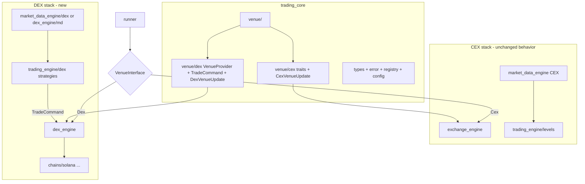

# Proposal: Venue split — `trading_core` + `dex_engine`

**Version**: 2.1  
**Date**: May 2026  
**Status**: Draft  
**Prerequisites**: None (foundational)  
**Next**: [Proposal 02 — Solana](02-solana-integration.md) implements `dex_engine/chains/solana`

## Executive summary

Split the system into **two parallel venue stacks**:

- **CEX** — existing `exchange_engine` + `market_data_engine` (CEX paths) + `trading_engine/levels`. Behavior **must not change**; only wiring and module layout evolve.
- **DEX** — new **`dex_engine`** crate with chain-specific modules (`solana`, …), shared DEX state/commands, and DEX strategies in `trading_engine` (not spot levels).

**`trading_core`** becomes the home for **venue-agnostic** primitives and a clear **`venue/cex`** vs **`venue/dex`** split. CEX-specific traits and channel types move under `venue/cex`; DEX types and `VenueProvider` live under `venue/dex`. No DEX fields on `ExchangeState`; no `TradingClient` inside DEX code.

---

## Principles

1. **CEX logic frozen** — Binance, Bybit, k-paper, levels, reconciliation, and `TradingClient` flows stay as-is; wrapped by `VenueInterface::Cex` (facade), not rewritten.
2. **DEX is separate** — `dex_engine` owns chain I/O, wallet state, pending transactions, and `TradeCommand` execution.
3. **Shared platform only** — `Pair`, `Decimal`, `EngineError`, `SymbolRegistry`, shutdown/channels *patterns*, Mongo/trace/gateway *aggregation* — not shared order semantics.
4. **Chain plugins** — Inside `dex_engine`, each chain is like a CEX exchange folder today (`exchanges/binance`, `exchanges/k_paper`).
5. **DEX “levels” = strategies** — Liquidation/swap policy lives in `trading_engine` (DEX module); `dex_engine` executes; not `config/levels.json` Binding levels.

---

## Target architecture



---

## Crate layout

### `trading_core` — `venue/cex` and `venue/dex` (not CEX at crate root)

Today CEX venue concepts sit at the **crate root** (`traits/`, `channels/exchange`, `types/exchange`). That was fine for a CEX-only system; with DEX it becomes ambiguous. **All venue-specific code moves under `venue/`**; platform code stays at root.

#### Target tree (`libs/trading_core/src/`)

```
lib.rs
├── venue/
│   ├── mod.rs              # VenueInterface, VenueId, runner config
│   ├── cex/
│   │   ├── mod.rs
│   │   ├── traits/
│   │   │   ├── trading.rs          # TradingClient (from traits/trading.rs)
│   │   │   ├── exchange_driver.rs  # ExchangeDriver
│   │   │   ├── market_data.rs      # CEX MD driver traits
│   │   │   └── private_data.rs
│   │   ├── channels/
│   │   │   └── update.rs           # ExchangeUpdate (from channels/exchange.rs)
│   │   └── types/
│   │       └── exchange.rs         # Order, OrderRequest, Balance, … (from types/exchange.rs)
│   └── dex/
│       ├── mod.rs
│       ├── provider.rs             # VenueProvider
│       ├── command.rs              # TradeCommand
│       ├── channels/
│       │   └── update.rs           # DexVenueUpdate
│       └── types.rs                # PendingTransaction, ExecutionResult, protocol IDs
├── types/                  # shared: common, asset, market_data (no orders)
├── channels/               # indicators, market_data only (CEX/DEX venue channels live under venue/)
├── traits/                 # DEPRECATED shims → pub use venue::cex::…
├── rest/, grpc/, websocket/, registry/, …   # platform — unchanged
```

| Path | Contents |
|------|----------|
| `venue/mod.rs` | `VenueInterface` enum (`Cex` \| `Dex`), `VenueId`, runner-facing config |
| **`venue/cex/`** | Everything needed to talk to a **centralized** venue: traits, `CexVenueUpdate`, order/balance/position types |
| **`venue/dex/`** | Everything needed to talk to an **on-chain** venue: `VenueProvider`, `TradeCommand`, `DexVenueUpdate`, wallet/tx types |
| `types/` (root) | **Shared only**: `Pair`, `Instrument`, `Decimal`, `Exchange` enum, timestamps — **no** `OrderRequest` / DEX commands here |
| `channels/` (root) | Cross-cutting only (`indicators`, generic `market_data`); **not** `ExchangeUpdate` |

#### Move map (Phase 1 — file moves + re-exports)

| Today | After |
|-------|--------|
| `traits/trading.rs` | `venue/cex/traits/trading.rs` |
| `traits/exchange_driver.rs` | `venue/cex/traits/exchange_driver.rs` |
| `traits/market_data.rs`, `private_data.rs` | `venue/cex/traits/` (CEX MD/private; DEX MD traits stay chain-local in `dex_engine` until needed) |
| `channels/exchange.rs` | `venue/cex/channels/update.rs` (`CexVenueUpdate` alias = `ExchangeUpdate` during migration) |
| `types/exchange.rs` | `venue/cex/types/exchange.rs` |
| *(new)* | `venue/dex/*` — no moves from CEX paths |

**Migration (non-breaking):**

```rust
// libs/trading_core/src/traits/mod.rs (shim until call sites updated)
pub use crate::venue::cex::traits::*;

// libs/trading_core/src/channels/mod.rs
pub use crate::venue::cex::channels::update::{ExchangeUpdate, ExchangeUpdateSender, …};
```

- `trading_core::traits::TradingClient` → `trading_core::venue::cex::TradingClient` (preferred import).
- **Do not** add DEX types to `traits/` or root `types/exchange.rs`.

**Rule:** If it is CEX order lifecycle or `TradingClient`, it lives under **`venue/cex`**. If it is chain tx / `VenueProvider`, it lives under **`venue/dex`**. Root `trading_core` is platform only.

### `exchange_engine` — CEX only (today)

- Stays responsible for **CEX** venues only.
- `VenueInterface::Cex` holds `Arc<ExchangeStateManager>`, `TradingClient`, existing `run()` — **no code path changes** in phase 1.
- Do **not** add `DexWalletState` or DEX commands to `ExchangeState`.

### `dex_engine` — new workspace member

```
src/dex_engine/
├── Cargo.toml
├── src/
│   ├── lib.rs
│   ├── config.rs          # DexEngineConfig, chain selector
│   ├── run.rs               # bootstrap, shutdown, spawn chain driver
│   ├── state/
│   │   ├── mod.rs
│   │   ├── state.rs         # wallet, pending txs (DEX-only)
│   │   ├── manager.rs       # DexStateManager
│   │   ├── publisher.rs     # DexVenueUpdate broadcast
│   │   └── reconciler.rs    # on-chain vs internal
│   └── chains/
│       ├── mod.rs
│       └── solana/          # Proposal 02
│           ├── mod.rs
│           ├── config.rs
│           ├── provider.rs  # impl VenueProvider
│           ├── driver.rs    # RPC/WS loop
│           ├── rpc.rs
│           └── protocols/   # marginfi, ...
```

| Layer | Responsibility |
|-------|----------------|
| **`dex_engine` (core)** | `DexStateManager`, reconcile, publish `DexVenueUpdate`, route `TradeCommand` to active chain’s `VenueProvider` |
| **`chains/<chain>/`** | RPC/WS, signing, decoders, protocol-specific tx build — implements `trading_core::venue::dex::VenueProvider` |

### `market_data_engine`

| Path | Role |
|------|------|
| **Existing CEX clients** | Unchanged (Binance, Bybit, k-paper WS) |
| **`exchanges/dex/` or `dex/`** | Ingest chain-specific feeds → `MarketDataUpdate` DEX variants (e.g. `DexAccountHealth`) — can start in 02 with Solana-only |

### `trading_engine`

| Path | Role |
|------|------|
| **`levels/`** | **CEX only** — `LevelExecutor` + `TradingClient` (unchanged) |
| **`dex/`** (new) | Liquidation / swap **strategies**: subscribe to DEX market + venue updates, emit `TradeCommand`, call `dex_engine` API |

### `runner`

- Construct **`VenueInterface::Cex`** from `bot.json` when `exchange` is Binance / Bybit / Paper (current path).
- Later: `venue: dex` in config constructs **`VenueInterface::Dex`** + `dex_engine::run()`.
- **No mixed venue** in v1 — one process, one primary execution venue per config (or explicit dual-venue mode later).

### `gateway` / CLI

- Monitoring aggregates **two sources**: existing CEX state + `DexStateManager` (separate panels or merged view later).
- No assumption that orders and transactions live in one map.

---

## What DEX reuses vs what it does not

| Reuse (platform) | Do not reuse (CEX pipeline) |
|------------------|-----------------------------|
| `trading_core` errors, `Pair`, registry | `TradingClient`, `OrderRequest` |
| Broadcast channel pattern | `ExchangeUpdate` semantics |
| Runner shutdown / Mongo patterns | `ExchangeDriver`, CEX WS handlers |
| Optional indicator price feed | `TradingStateManager` order lifecycle |
| Asset metadata *shape* (optional) | `LevelExecutor`, CEX reconciliation |

---

## `VenueProvider` (in `trading_core::venue::dex`)

Chain-agnostic contract implemented per chain under `dex_engine/chains/`:

- `bootstrap_state()` — on-chain snapshot
- `stream_updates()` — `DexVenueUpdate` (balance, tx status, account data)
- `execute(TradeCommand)` — build/sign/submit
- `reconcile()` — internal vs chain
- `venue_id()` — `VenueId::Solana`, …

**Not** an `ExecutionInterface` that wraps both CEX and DEX in one trait for levels — CEX keeps `TradingClient`; DEX strategies talk to `dex_engine` directly or via a thin `DexExecution` port in `trading_engine::dex`.

---

## `TradeCommand` (in `trading_core::venue::dex`)

DEX-only command enum (new):

- `Liquidate { protocol, account, … }`
- `DexSwap { … }`
- (future) `DexLimitOrder { … }`

CEX continues to use **`OrderRequest`** — no merge into one mega-enum for level posting.

---

## Implementation phases

### Phase 1 — Layout + types (no behavior change)

- [x] Create `libs/trading_core/src/venue/{mod,cex,dex}/` per move map above
- [x] CEX files under `venue/cex/`; `traits/` shim only (duplicate files removed)
- [x] `venue/dex/` types (`VenueProvider`, `TradeCommand`, `DexVenueUpdate`, `DexError`)
- [x] Workspace crate `dex_engine` + mock `VenueProvider` tests
- [x] `runner::venue::VenueInterface` + `venue.mode` in config
- [ ] CEX regression: k-paper levels integration (manual)
- [x] No DEX in `exchange_engine`

### Phase 2 — `dex_engine` core

- [x] `DexStateManager`, `DexVenueUpdate`, `DexState`, reconciler loop in `run()`
- [x] `DexEngineRuntime` + `execute()`
- [x] `MarketDataUpdate::DexAccountHealth` in `trading_core`

### Phase 3 — Solana chain plugin ([Proposal 02](02-solana-integration.md)) — **deferred**

- [ ] `dex_engine/chains/solana` implements `VenueProvider`
- [ ] MD driver publishes real account health
- [ ] (stub) `trading_engine::dex` liquidation strategy compiles; executes via mock only

### Phase 4 — Gateway / ops

- [x] gRPC `MonitoringData.dex` snapshot (wallet + pending txs)
- [x] Dual-venue: `venue.mode: "both"` + `config/bot.both.example.json`
- [x] Runner mode `dex` for DEX strategy loop

---

## Success criteria

- [ ] CEX paths (Paper levels, Binance/Bybit if configured) pass existing tests with **no behavioral diff**
- [ ] CEX code lives only under `trading_core::venue::cex` (root `traits/` / `channels/exchange` are shims); DEX types only under `venue::dex`
- [ ] No new DEX types in `exchange_engine::state` or `types/exchange.rs` at crate root
- [ ] `dex_engine` exists with `chains/` layout and Solana stub compiles
- [ ] Proposal 02 can implement Solana only under `dex_engine/chains/solana` without touching CEX crates

---

## Out of scope (this proposal)

- Migrating `LevelExecutor` or spot levels to DEX
- Merging `ExchangeState` with DEX wallet state
- Unified `ExecutionInterface` for all trading_engine code
- Ethereum / other chains (folder stubs only)
- Production key custody / HSM

---

## Design references

- Design log: [002-dex-preparation](../.cursor/design-log/002-dex-preparation.md)
- CEX layout reference: `src/exchange_engine/src/exchanges/`
